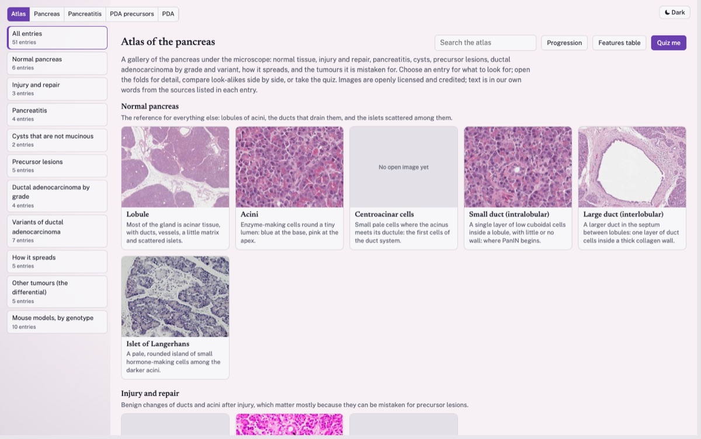
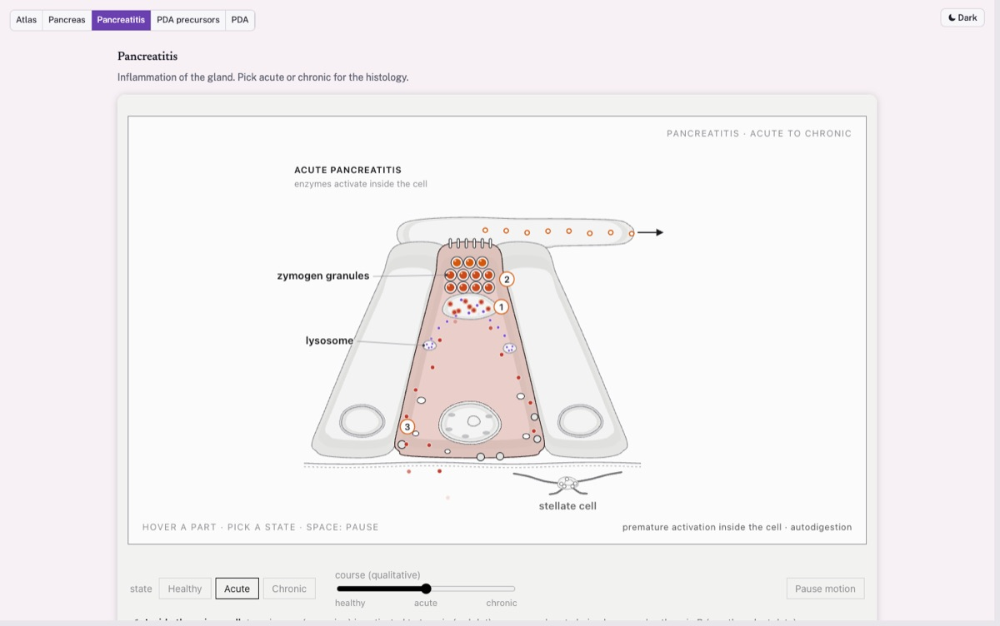
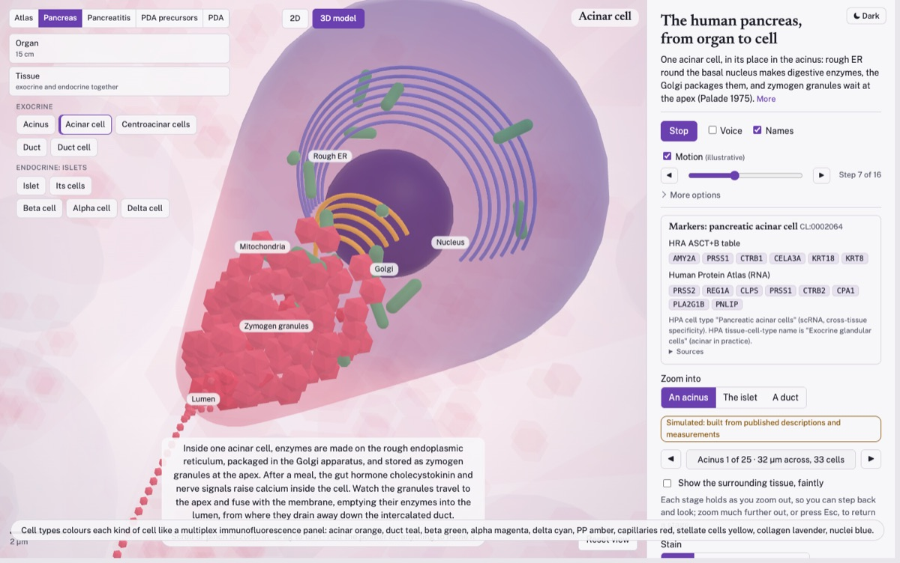

# Pancreas: Organ to Disease

*An open learning atlas of H&E, mechanisms and 3D anatomy, from the normal gland to PDA*

**[Open the learning tool →](https://osamashiraz.github.io/pancreas-atlas/)** (runs in the browser; Chrome or Edge recommended)

A free, open learning tool that walks from the normal human pancreas, its exocrine and endocrine parts, to its diseases: pancreatitis, the precursor lesions of pancreatic cancer, and pancreatic ductal adenocarcinoma (PDA). Every step is shown three ways: an interactive illustrated figure of the mechanism, real H&E micrographs of what it looks like under the microscope, and an interactive 3D model that zooms from the whole organ down to single cells.



## A note on terms

Pancreatic ductal adenocarcinoma is written several ways in the literature: **PDAC** (the most common abbreviation), **PDA**, "pancreatic adenocarcinoma", "ductal adenocarcinoma of the pancreas" and, loosely, "pancreatic cancer". All mean the same tumour, the ductal-type adenocarcinoma that makes up most pancreatic cancers. This repository uses **PDA** throughout.

## How it relates to other resources

This is not a reference work. For depth, use the comprehensive resources, for example:

- [PathologyOutlines.com](https://www.pathologyoutlines.com/pancreas.html), for the full surgical pathology of the pancreas: every entity, its criteria, its differential diagnosis, its stains and the WHO terms;
- [Pancreatlas](https://pancreatlas.org) (Vanderbilt), for large collections of high-resolution human pancreas and islet images.

This tool is for quick, simple learning. It links the normal histology, biology and cell biology of the pancreas to its main diseases on one page each, so you can get oriented before going deeper.

## Why I built this

I am a bioinformatician working on spatial profiling of pancreatic cancer. To read these data well, I needed to understand the biology behind them: the molecular and cancer biology, and the histology and pathology of the pancreas and its diseases. I made this resource for others in the same position: students, trainees and computational biologists new to the pancreas. I am still learning myself, so corrections and suggestions are very welcome (see [Feedback, collaboration and contributions](#feedback-collaboration-and-contributions)).

**That understanding starts with H&E.** Haematoxylin and eosin were first combined in 1876. About 150 years later, H&E is still the standard stain in medicine. Pathologists use it to see what a disease looks like, to diagnose it, and to grade and stage tumours, which informs prognosis.

I gathered what I learned from papers, textbooks and open resources. But I could not find one open resource that linked the normal pancreas, with its exocrine and endocrine functions, to the diseases of each part in a single overview. So I built one as a learning tool, using Claude Code and agentic pipelines. I picked up these skills recently in my Agentic AI course at Johns Hopkins University. I wanted to apply them to something worth learning from.

Understanding the biology and pathology of the pancreas has directly improved my own data analyses. Seeing histology beside spatial data is how I connect the two. In the clinic, diagnosis, grading and staging still rest on H&E. Spatial transcriptomics may one day add to that. Putting them side by side shows me where H&E is already enough (recognising tissue, lesions, grade and invasion) and where spatial data may add more: cell states and neighbourhoods that look alike on H&E. If you are new to the pancreas, start with the [suggested route](#a-suggested-route) below.

## A quick tour

The bar at the top left switches between five pages.

**Atlas.** This is a gallery of 51 openly licensed micrographs in ten groups: normal pancreas, injury and repair, pancreatitis, cysts, precursor lesions, PDA by grade, its variants, how it spreads, the other tumours it is mistaken for, and mouse models by genotype. Each entry gives a one-line description, two to four numbered "look for" pins placed on the picture, and one line to remember. Folds below hold the features under the microscope, look-alikes, facts and sources with page numbers. Further tools: a **side by side** comparison with a look-alike, a **progression** strip with the genetic changes, a **features table** and a **quiz**. Entries can be linked, e.g. [`#atlas=pda-poor`](https://osamashiraz.github.io/pancreas-atlas/#atlas=pda-poor).

**Pancreas: organ to cell.** The page starts with the organ, its exocrine tissue and its islets. It then shows how the gland secretes: digestive juice into the duodenum, and hormones into the blood. Next come the H&E of each tissue (lobule, acini, ducts, islet). Last, each cell's job sits beside its H&E: enzyme secretion by acinar cells, bicarbonate by duct cells, and glucose control by the islet.


**Pancreatitis.** It shows how the gland injures itself: trypsin activated inside the acinar cell, in acute pancreatitis. Then it shows how repeated injury becomes chronic pancreatitis: stellate cells, collagen and lost acini. The H&E of normal, acute and chronic follows, with the link to precursors through acinar-to-ductal metaplasia.



**PDA precursors.** The PanIN → PDA progression model steps from a normal duct through acinar-to-ductal metaplasia and low- and high-grade PanIN to invasive PDA. Under it, a timeline shows the genetic changes (KRAS, CDKN2A, TP53, SMAD4). A KRAS figure shows what the first driver does. The page ends with a comparison of PanIN, IPMN and MCN: where each arises, its histology, and how they differ.


**PDA.** The page opens with the hallmark of PDA, desmoplasia. A slider takes the tissue from an early PanIN among normal acini to invasive glands in dense collagen, with collapsed vessels and T cells held out. Then come grades and histological variants with their H&E, and finally where PDA spreads.


**Interactive 3D model** (the "Interactive 3D model" button on the Pancreas page). You can zoom continuously from the reference organ (about 15 cm, from the Human Reference Atlas) through its lobules and duct tree to a core of tissue. From there you go to an acinus, islet or duct, then its cells, and finally one cell with its organelles. Everything is at true scale, in H&E or cell-type colours. **Play the journey** gives a 16-step narrated tour. Use the **seek bar** under it to go back or forward to any step.

| The organ                                             | A step of the narrated journey                                                                     |
| ----------------------------------------------------- | -------------------------------------------------------------------------------------------------- |
|  |  |

### A suggested route

1. **Pancreas**: the organ, then exocrine tissue and islets, then each cell's job beside its H&E.
2. **Atlas → Normal pancreas**: learn the normal patterns with the pins on.
3. **Pancreatitis**, then **PDA precursors**, then **PDA**, following the disease from injury to invasion.
4. Back to the **Atlas** for look-alikes (side by side) and the **quiz** to test yourself.
5. The **3D model** and its journey, whenever you want to see how the scales fit together.

In every figure, hover over or tap a part to see its name and a short sourced explanation. **Sources & notes** under each figure open the full references.

## What is real, what is drawn

Every structure in the 3D model has one of three labels, and the viewer shows it:

- **source**: drawn by the Human Reference Atlas from the Visible Human Project (organ shape, main ducts, large vessels);
- **traced**: followed from a published image;
- **simulated**: placed by a written rule from published measurements (small vessels, lymph nodes, lobules, acini, islets, cells).

Every number either names its source or is marked *not yet sourced* in the code, and the tests fail if one is missing. The illustrated figures are simplified drawings of mechanisms, not to scale. The micrographs are examples chosen to show a feature, not a measure of how common it is.

## More about each part

### The 3D model: the organ, opened layer by layer

The model shows the reference pancreas (head, neck, body, tail, uncinate process) with the main and accessory pancreatic ducts, bile duct and ampulla, and the coeliac, splenic, hepatic and superior mesenteric vessels. Thirty tissue sites (ten each in head, body and tail, scattered at random) lie hidden in the gland. Each shows its region's tissue (islets in the uncinate process are rich in PP cells). Zoom in on any part of the organ, and one of the sites nearest the pointer is picked at random and brought to the middle of the view.

Zooming into a site opens the gland **in place, layer by layer**, the way [MouseBio_3D](https://github.com/Qasim-Hussain-Code/MouseBio_3D) opens the mouse. A line goes into the gland at the site, and as you zoom, the organ's surface opens round it. Inside, the **lobules** stand cut across, with pale septa of connective tissue between them. Round the line, the lobules near the site open in turn to show what fills them. Inside is the **duct tree**: a large interlobular duct with its artery and vein, then interlobular, intralobular and terminal ducts ending in grape-like clusters of acini. Among them lie the **islets**, twice as dense in the tail as in the head. At the bottom of the opening lies a **core of tissue**, cut flat through its islet. Each outer layer stays as a ring round the next, and zooming out closes them again.

| Organ                           | The surface opens                                          | Lobules and their ducts                                       | Tissue core                                                     |
| ------------------------------- | ---------------------------------------------------------- | ------------------------------------------------------------- | --------------------------------------------------------------- |
|  |  |  |  |

**Compare head, body and tail** puts the three regions' lobule columns side by side, each opened to its duct tree and islets:


### Inside the tissue: how the pancreas works

The pancreas is two organs in one, and the model shows both:

- **Exocrine (digestion)**: about 98% of the tissue. Wedge-shaped *acinar cells*, arranged like orange segments around a tiny lumen, make digestive enzymes. Rough ER around the basal nucleus synthesises them, the Golgi packages them, and *zymogen granules* wait at the cell apex for release. Each acinus empties into its own *intercalated duct*, lined at its start by *centroacinar cells*. Ducts merge into intralobular, interlobular and finally the main pancreatic duct, which joins the bile duct at the ampulla in the duodenum. *Duct cells* add bicarbonate-rich fluid (through CFTR and SLC26A6) that carries the enzymes and neutralises stomach acid.
- **Endocrine (blood sugar)**: about 1–2% of the tissue. *Islets of Langerhans* (about 110 µm, a few hundred cells each) contain beta cells (insulin), alpha cells (glucagon), delta cells (somatostatin) and PP cells, intermixed along a dense capillary bed as in human islets. A *beta cell* is shown with its insulin granules (dense crystalline cores in pale halos), primary cilium and neighbouring capillary.

| Acinus                            | Islet (cell-type colours)                 | Acinar cell                                 | Beta cell                               |
| --------------------------------- | ----------------------------------------- | ------------------------------------------- | --------------------------------------- |
|  |  |  |  |

### 3D model features

- Continuous zoom from organ to organelle, with a scale bar; **Esc** steps back a level.
- **Layers opened in place**: organ surface → lobules → duct tree → tissue core, each a ring round the next; the view turns to look down the opening until you turn it yourself.
- Three branches to follow: **acinus → acinar cells → one acinar cell**, **islet → islet cells → beta cell**, **duct → duct cells → one duct cell**.
- **Stain**: H&E (purple nuclei, pink cytoplasm, red granules, pale islets) or **Cell types** (immunofluorescence-like colours).
- **Cut open** a structure, **slice apart** (organ into transverse slices, tissue into serial sections), **split screen** to compare two views, **compare head, body and tail**.
- **Beta, alpha and delta cells**, each with its own granules (beta ~350 nm with clear halos, alpha ~200 nm and dense, delta ~250 nm); the delta cell reaches its neighbours with long processes.
- **Secretion in motion** (Motion on). Zymogen granules travel to the apex and release enzymes down the duct. Duct cells secrete bicarbonate through CFTR and SLC26A6. A beta cell takes up glucose and releases insulin into its capillary. Alpha cells release glucagon, and delta cells release somatostatin beside their neighbours. The journey narrates each.
- **Marker genes** for the cell in view or clicked, from the HRA ASCT+B table and the Human Protein Atlas, each linking to its HPA page.
- **Play the journey**: a 16-step narrated tour in Google's UK English female voice (Chrome; other browsers use a standard UK voice). A **seek bar** (◀ step slider ▶) jumps back or forward to any step.
- Click any cell or structure to name it, isolate it or fade it.
- A quiet side panel: sources and the less-used controls (voice, speed, split screen, slice apart, comparison) are folded away until opened.
- **Links to a view**: the address follows what you are looking at, e.g. [`#site=9&view=islet&stain=if`](https://osamashiraz.github.io/pancreas-atlas/#site=9&view=islet&stain=if), so a view can be shared or used in teaching.

### Histology views

On the disease pages, picking a lesion opens its **histology view**. It starts with a drawing in H&E colours of the lesion's key architecture. Real H&E micrographs follow (open-licensed, credited) with the same features numbered alike, then high-power views of the cells.

| PanIN                                                                                                                                                                                             | IPMN                                                                                                                                                                                                   | MCN                                                                                                                                                         |
| ------------------------------------------------------------------------------------------------------------------------------------------------------------------------------------------------- | ------------------------------------------------------------------------------------------------------------------------------------------------------------------------------------------------------ | ----------------------------------------------------------------------------------------------------------------------------------------------------------- |
|                                                                                                                                                          |                                                                                                                                                                 |                                                                                                                        |
| Normal duct → PanIN-1a → 1b → 2 → 3: low cuboidal cells become tall columnar with apical mucin, then micropapillae and papillae with crowded, atypical nuclei; KRAS and telomere shortening first | Gross specimen and H&E: dilated main duct and branch-duct cysts that open into it; tall mucinous papillae (gastric type), complex papillae (pancreatobiliary type); ordinary stroma, no ovarian stroma | Fibrous capsule, mucin-filled cyst, mucinous columnar lining, and the dense, cellular ovarian-type stroma of spindle cells with wavy nuclei that defines it |

Images: Hackeng et al., *Diagn Pathol* 2016 (CC BY 4.0); Shibata et al., *Clin J Gastroenterol* 2017 (CC BY 4.0); Nephron and Humpath, Wikimedia Commons (CC BY-SA 3.0). See [`viewer/assets/histology/CREDITS.md`](viewer/assets/histology/CREDITS.md).

Each comes with a card on its appearance, grading, genes, who it affects and survival, in my own words, citing Hingorani 2007, Rodriguez et al. 2007, *The Pancreas: An Integrated Textbook* (Beger et al., 4th ed., 2023) and *Robbins and Cotran Pathologic Basis of Disease* (9th ed.). Placement on the organ is simulated by rule; drawn sizes follow the stated sizes.

### The organs round the pancreas

The liver, gallbladder, kidneys and their vessels, aorta, inferior vena cava and transverse colon are extracted unchanged from the same HRA body model (`repo/scripts/human/extract_neighbours.py`). They are shown faintly round the pancreas, with their names, when “Show nearby organs” is ticked (off by default). The HRA v2.0 body model has no stomach or adrenal glands, so they are not shown.

## Datasets and sources

| What                                          | Source                                                                                                                                                                                                                                                              | Use in the model                                                                 |
| --------------------------------------------- | ------------------------------------------------------------------------------------------------------------------------------------------------------------------------------------------------------------------------------------------------------------------- | -------------------------------------------------------------------------------- |
| Organ, ducts, large vessels, duodenum, spleen | **HRA 3D Reference Object Library** v2.0 (HuBMAP), derived from the **Visible Human Project** (U.S. National Library of Medicine), male and female; CC BY 4.0                                                                                                       | 29 named meshes per sex copied byte-for-byte; organ volume by voxelisation       |
| Cell types and ontology terms                 | **HRA ASCT+B table** for the pancreas and the HRA crosswalk                                                                                                                                                                                                         | Cell-type names, UBERON/FMA/CL identifiers, islet composition                    |
| Islet number, size, clustering                | Hahn et al., *Commun Biol* 2021                                                                                                                                                                                                                                     | ~1.7–1.8 million islets per organ, peripheral clusters                           |
| Regional islet density                        | Wang et al., *PLoS One* 2013                                                                                                                                                                                                                                        | Tail about twice head and body                                                   |
| Islet architecture                            | Cabrera et al., *PNAS* 2006; Brissova et al., *J Histochem Cytochem* 2005                                                                                                                                                                                           | Intermixed alpha/beta cells, 71% heterotypic contacts                            |
| Beta-cell volume                              | Reers et al., *Eur J Endocrinol* 2009                                                                                                                                                                                                                               | Beta-cell volume fraction (2.3%)                                                 |
| Tissue architecture                           | Kiemen et al. (CODA), *Nat Methods* 2022                                                                                                                                                                                                                            | Grape-like acinar clusters, collagen along ducts                                 |
| Ducts and centroacinar cells                  | Endo et al. 2002 (rat); Beer et al. 2016                                                                                                                                                                                                                            | One intercalated duct per acinus, no anastomoses                                 |
| Cell biology                                  | Palade 1975; Messenger et al. 2014; Berclaz et al. 2016; Steward & Ishiguro 2009; Hegyi & Rakonczay 2015; diIorio et al. 2014                                                                                                                                       | Secretory pathway, zymogen and insulin granules, duct secretion, cilia           |
| Marker genes                                  | **HRA ASCT+B** pancreas v1.3 (doi:10.48539/HBM336.TBNP.923); **Human Protein Atlas** v26.0 (CC BY 4.0)                                                                                                                                                              | Marker panel per cell type (`repo/data/human-pancreas-markers.json`)             |
| Pancreatitis and PDA                          | Kumar, Abbas, Aster, *Robbins and Cotran*, 9th ed., 2015 (ch. 19); Beger et al., *The Pancreas*, 4th ed., 2023 (ch. 7, 17, 41, 47, 119, 125, 128, 130, 134, 137); images from Wikimedia Commons (Patho; Université Laval; KGH; Singh et al. 2016; Wang et al. 2016) | Organ changes, histology drawings, cards, comparison tables                      |
| Organs round the pancreas                     | HRA 3D Reference Object Library v2.0, male united model                                                                                                                                                                                                             | Liver, gallbladder, kidneys, great vessels, colon (geometry unchanged)           |
| Precursor lesions                             | Hingorani, *Gastroenterology* 2007 (doi:10.1053/j.gastro.2007.05.059); Rodriguez et al., *Gastroenterology* 2007; Beger et al., *The Pancreas*, 4th ed., Wiley 2023 (ch. 81, 84, 86, 125, 126); Kumar, Abbas, Aster, *Robbins and Cotran*, 9th ed., 2015 (ch. 19)   | Where PanIN, MCN and IPMN arise; sizes, grades, genes; architecture of each view |
| Normal anatomy (checks)                       | Gorelick & Williams, eds., *The Pancreas: Biology and Physiology*, APA 2021 (CC BY-NC-ND; ch. 1 Longnecker)                                                                                                                                                         | Islet size and number, endocrine fraction, zymogen granule size                  |
| Secretion and islet cells                     | Lee et al., *Physiol Rev* 2012; Rorsman & Ashcroft, *Physiol Rev* 2018; Brereton et al., *J Histochem Cytochem* 2015; Arrojo e Drigo et al., *Nat Commun* 2019                                                                                                      | Bicarbonate and insulin secretion; granule sizes; delta-cell processes           |
| Teaching text                                 | StatPearls (NCBI Bookshelf, CC BY 4.0); Columbia and Basel histology notes; Human Protein Atlas                                                                                                                                                                     | Narration, paraphrased in my own words with credit                              |

Full references with DOIs: [`docs/SOURCES.md`](docs/SOURCES.md). Values still awaiting a source (for example acinar cell height, duct radii, lobule size, organelle counts) are listed in [`docs/SPEC.md`](docs/SPEC.md) §9.

## How it is built

- **Organ**: meshes extracted unchanged from the HRA united body models. Small arteries (gastroduodenal, pancreaticoduodenal arcades, dorsal/great/caudal pancreatic) are routed by shortest path around drawn structures. Lymph nodes are placed at the Japan Pancreas Society stations, checked against its eighth edition (2024). Gray's Anatomy, cited for vessel anatomy, is still to be checked.
- **Tissue**: deterministic builders (Python, and a TypeScript generator that also runs in the browser) grow a duct tree, bud acini on their own intercalated ducts, route capillaries so every acinus is within reach, and add stroma and one islet. Cells then grow until they meet a neighbour. Tests check the rules: no overlapping acini, one duct per acinus, packing above 45%, islet composition and size.
- **Figures**: interactive isometric SVG figures built with the anima figure kit. Each has its own source script and a sources block, and an automatic layout audit checks every figure.
- **Viewer**: a single self-contained HTML page (three.js) with the models embedded, so it can be hosted anywhere static. The layered openings follow MouseBio_3D's zoom-unfold: each opening grows with the zoom to nearly half the height of the view, outer layers stay as rings, and vessels and ducts of the organ are left uncut.

## Repository layout

| Path                               | What                                                                                                                                                                                                                     |
| ---------------------------------- | ------------------------------------------------------------------------------------------------------------------------------------------------------------------------------------------------------------------------ |
| `dist/pancreas-organ-to-cell.html` | The built viewer (published to GitHub Pages)                                                                                                                                                                             |
| `dist/atlas/`                      | The atlas images, loaded by the page only when the atlas is opened                                                                                                                                                       |
| `dist/figures/`                    | The interactive illustrated figures, embedded in the pages                                                                                                                                                               |
| `viewer/`                          | Viewer sources (`template.html`, `src/app.js`, `src/atlas.json`, `src/generator.js`), images (`assets/`), build script, tests (`test/smoke.py`, `test/atlas_check.py`, `test/profile.py`), earlier versions in `legacy/` |
| `repo/`                            | Model data and the code that builds and tests it: inventory, generators, loader, tests, Python builders                                                                                                                  |
| `docs/`                            | Specification, backlog, change history, sources, README images                                                                                                                                                           |
| `scripts/install_into_mousebio.sh` | Copies `repo/` into a MouseBio_3D checkout and runs its checks                                                                                                                                                           |
| `CLAUDE.md`                        | Working rules for continuing the project with Claude Code                                                                                                                                                                |

### Run it locally

Open `dist/pancreas-organ-to-cell.html` in a browser (it needs internet for three.js and fonts). To rebuild and test:

```bash
git clone https://github.com/Qasim-Hussain-Code/MouseBio_3D && cd MouseBio_3D && npm ci
bash ../pancreas-atlas/scripts/install_into_mousebio.sh .        # copy the module in, type-check, run its tests
python3 ../pancreas-atlas/viewer/build_viewer.py . ../pancreas-atlas/dist/pancreas-organ-to-cell.html
```

Python builders need `numpy` and `scipy`; the smoke test needs `playwright`. Pushing a new `dist/` to `main` republishes the GitHub Pages site.

## Feedback, collaboration and contributions

This work is evolving. Corrections, suggestions and contributions are very welcome: better or openly licensed images, errors in the biology, new topics (for example diabetes, or overlays of spatial data), or ideas for teaching with it. If you would like to contribute or collaborate, email me at **osamashirazshah@gmail.com**, or open an issue on this repository.

## Disclaimer

- **For education and research only. Not for medical use.** It is not a diagnostic tool, it gives no medical advice, and it is no substitute for a pathology textbook, a pathologist or a clinician.
- **It reflects my understanding** from what I have read and learned. I have tried to source and check every statement, but errors are possible. Please tell me if you find one.
- **Images are limited to open licences** (CC BY, CC BY-SA, CC0, public domain), each credited. Some entries therefore have small images, images with the source figure's arrows, or no image yet. Textbook and journal figures under copyright are not reproduced.
- The page text is in my own words, paraphrased from the cited sources.
- The 3D tissue and cells are simulated from published descriptions. The illustrated figures are simplified diagrams. Neither is a measurement of a patient.

## Limitations

This is a teaching and communication model, not a patient-specific or diagnostic one. The organ comes from one male and one female reference body. Everything below the organ scale is simulated from published descriptions, and some sizes are typical values not yet sourced (marked in the code and listed in the spec). Known issues are in [`docs/BACKLOG.md`](docs/BACKLOG.md).

## Licence and credit

- Code: MIT (see [`LICENSE`](LICENSE)).
- Model data derived from the HRA 3D Reference Object Library: CC BY 4.0 (see [`repo/public/atlas-human/NOTICE.md`](repo/public/atlas-human/NOTICE.md)). Cite: Börner K, et al. *Nat Methods* 2025;22:845–860. doi:10.1038/s41592-024-02563-5.
- Visible Human Project, U.S. National Library of Medicine.
- Narration and page text are in my own words, paraphrased from open sources (StatPearls CC BY 4.0, university histology notes, Human Protein Atlas) with credit.
