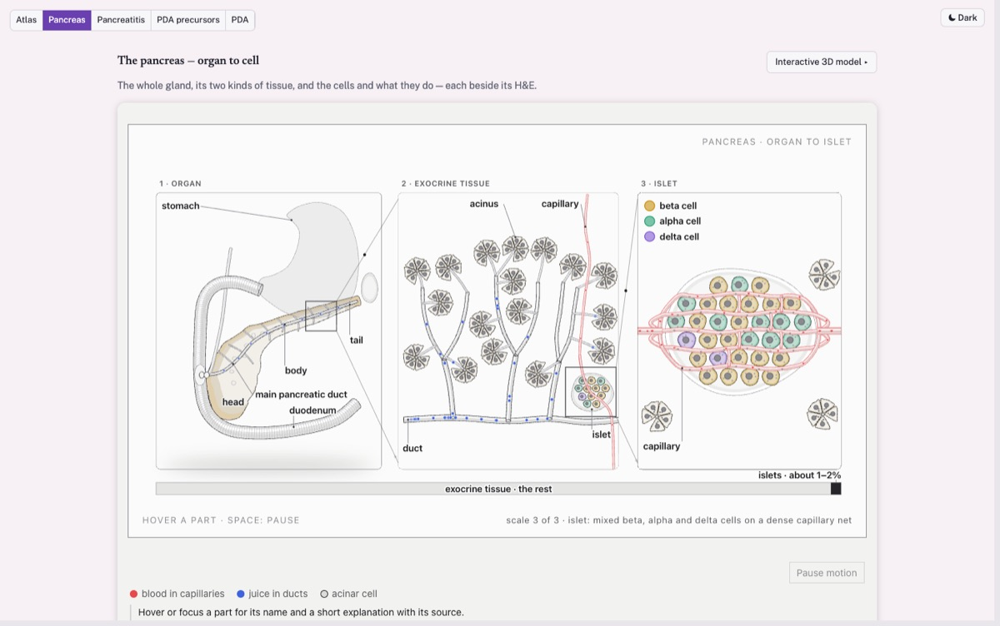
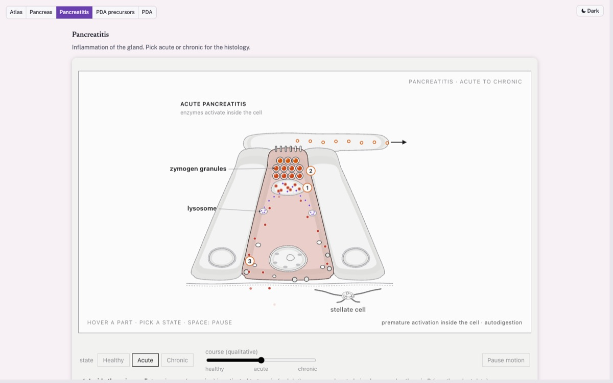
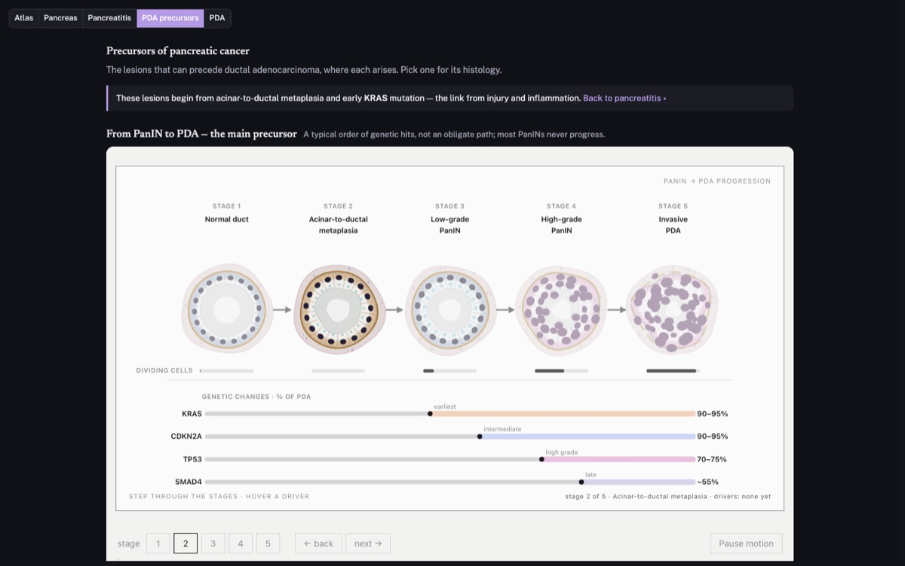
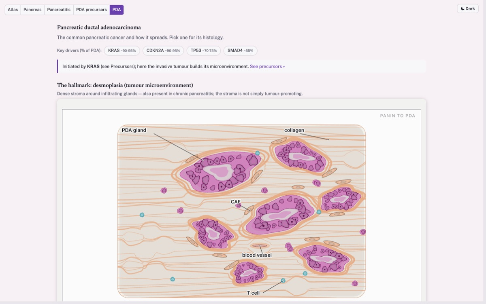
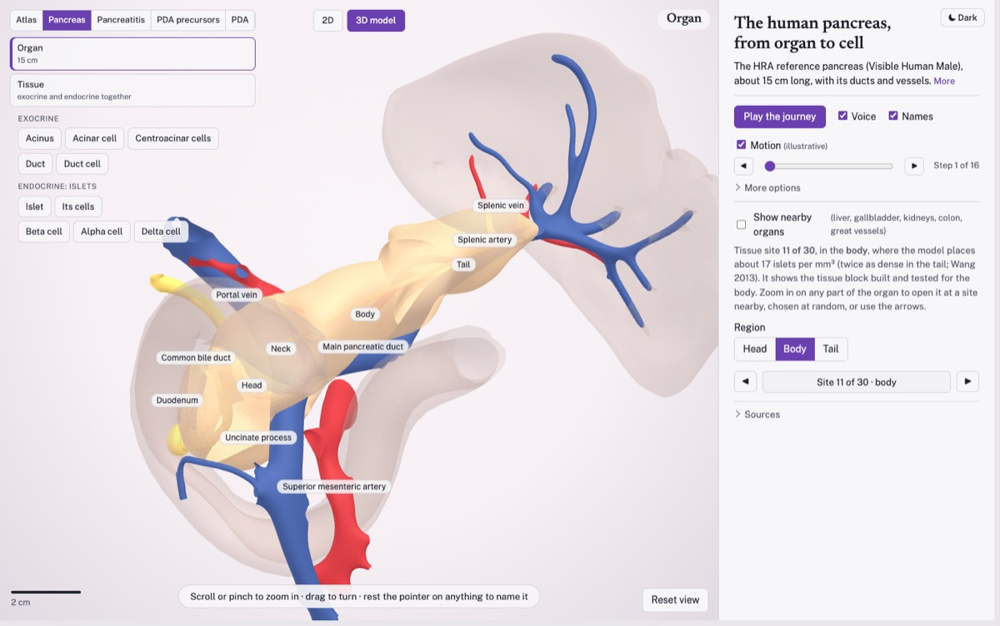
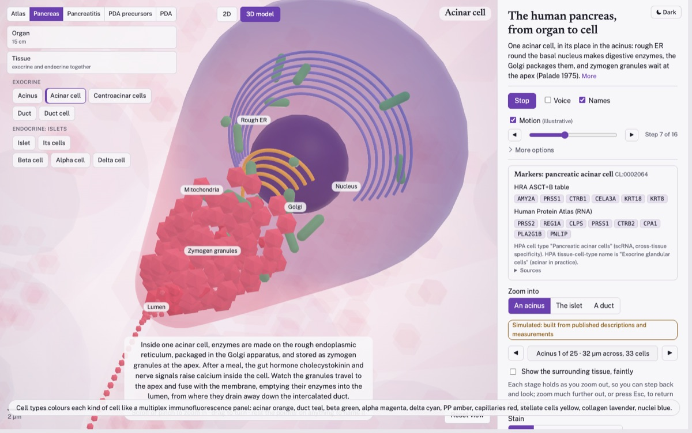
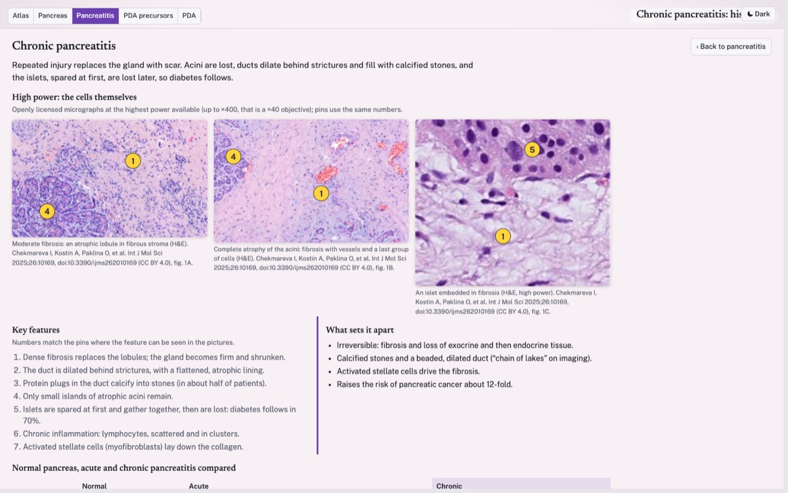

# Pancreas: Organ to Disease, a guide to the tool

This guide describes each page and the 3D model in more detail than the [README](../README.md). For a quick look, watch the [one-minute tour](https://osamashiraz.github.io/pancreas-atlas/video/pancreas-atlas-showcase.mp4) or [open the tool](https://osamashiraz.github.io/pancreas-atlas/).

## The five pages

The bar at the top left switches between five pages. The button at the top right switches between the light theme (the default) and a dark theme.

**Atlas.** This is a gallery of 51 entries in ten groups, with 79 openly licensed images: normal pancreas, injury and repair, pancreatitis, cysts, precursor lesions, PDA by grade, its variants, how it spreads, the other tumours it is mistaken for, and mouse models by genotype. Each entry gives a one-line description, numbered "look for" points (pinned on the picture where they can be seen), and one line to remember. Eight entries have no open image yet. Folds below hold the features under the microscope, look-alikes, facts and sources with page numbers. Further tools: a **side by side** comparison with a look-alike, a **progression** strip with the genetic changes, a **features table** and a **quiz**. Entries can be linked, e.g. [`#atlas=pda-poor`](https://osamashiraz.github.io/pancreas-atlas/#atlas=pda-poor).

**Pancreas: organ to cell.** The page starts with the organ, its exocrine tissue and its islets. It then shows how the gland secretes: digestive juice into the duodenum, and hormones into the blood. Next come the H&E of each tissue (lobule, acini, ducts, islet). Last, each cell's job sits beside its H&E: enzyme secretion by acinar cells, bicarbonate by duct cells, and glucose control by the islet.

**Pancreatitis.** It shows how the gland injures itself: trypsin activated inside the acinar cell, in acute pancreatitis. Then it shows how repeated injury becomes chronic pancreatitis: stellate cells, collagen and lost acini. The H&E of normal, acute and chronic follows, with the link to precursors through acinar-to-ductal metaplasia.

**PDA precursors.** The PanIN → PDA progression model steps from a normal duct through acinar-to-ductal metaplasia and low- and high-grade PanIN to invasive PDA. Under it, a timeline shows the genetic changes (KRAS, CDKN2A, TP53, SMAD4). A KRAS figure shows what the first driver does. The page ends with a comparison of PanIN, IPMN and MCN: where each arises, its histology, and how they differ.

**PDA.** The page opens with the hallmark of PDA, desmoplasia. A slider takes the tissue from an early PanIN among normal acini to invasive glands in dense collagen, with collapsed vessels and T cells held out. Then come grades and histological variants with their H&E, and finally where PDA spreads.

**Interactive 3D model** (the "Interactive 3D model" button on the Pancreas page; inside the model, a 2D / 3D model switch at the top goes back). You can zoom continuously from the reference organ (about 15 cm, from the Human Reference Atlas) through its lobules and duct tree to a core of tissue. From there you go to an acinus, islet or duct, then its cells, and finally one cell with its organelles. Everything is at true scale, in H&E or cell-type colours. **Play the journey** gives a 16-step narrated tour. Use the **seek bar** under it to go back or forward to any step.

| The organ                                             | A step of the narrated journey                                                                     |
| ----------------------------------------------------- | -------------------------------------------------------------------------------------------------- |
|  |  |

## The 3D model: the organ, opened layer by layer

The model shows the reference pancreas (head, neck, body, tail, uncinate process) with the main and accessory pancreatic ducts, bile duct and ampulla, and the coeliac, splenic, hepatic and superior mesenteric vessels. Thirty tissue sites (ten each in head, body and tail, scattered at random) lie hidden in the gland. Each shows its region's tissue (islets in the uncinate process are rich in PP cells). Zoom in on any part of the organ, and one of the sites nearest the pointer is picked at random and brought to the middle of the view.

Zooming into a site opens the gland **in place, layer by layer**. A line goes into the gland at the site, and as you zoom, the organ's surface opens round it. Inside, the **lobules** stand cut across, with pale septa of connective tissue between them. Round the line, the lobules near the site open in turn to show what fills them. Inside is the **duct tree**: a large interlobular duct with its artery and vein, then interlobular, intralobular and terminal ducts ending in grape-like clusters of acini. Among them lie the **islets**, twice as dense in the tail as in the head. At the bottom of the opening lies a **core of tissue**, cut flat through its islet. Each outer layer stays as a ring round the next, and zooming out closes them again.

| Organ                           | The surface opens                                          | Lobules and their ducts                                       | Tissue core                                                     |
| ------------------------------- | ---------------------------------------------------------- | ------------------------------------------------------------- | --------------------------------------------------------------- |
|  |  |  |  |

**Compare head, body and tail** puts the three regions' lobule columns side by side, each opened to its duct tree and islets:

## Inside the tissue: how the pancreas works

The pancreas is two organs in one, and the model shows both:

- **Exocrine (digestion)**: about 98% of the tissue. Wedge-shaped *acinar cells*, arranged like orange segments around a tiny lumen, make digestive enzymes. Rough ER around the basal nucleus synthesises them, the Golgi packages them, and *zymogen granules* wait at the cell apex for release. Each acinus empties into its own *intercalated duct*, lined at its start by *centroacinar cells*. Ducts merge into intralobular, interlobular and finally the main pancreatic duct, which joins the bile duct at the ampulla in the duodenum. *Duct cells* add bicarbonate-rich fluid (through CFTR and SLC26A6) that carries the enzymes and neutralises stomach acid.
- **Endocrine (blood sugar)**: about 1–2% of the tissue. *Islets of Langerhans* (about 110 µm, a few hundred cells each) contain beta cells (insulin), alpha cells (glucagon), delta cells (somatostatin) and PP cells, intermixed along a dense capillary bed as in human islets. A *beta cell* is shown with its insulin granules (dense crystalline cores in pale halos), primary cilium and neighbouring capillary.

| Acinus                            | Islet (cell-type colours)                 | Acinar cell                                 | Beta cell                               |
| --------------------------------- | ----------------------------------------- | ------------------------------------------- | --------------------------------------- |
|  |  |  |  |

## 3D model features

- Continuous zoom from organ to organelle, with a scale bar; **Esc** steps back a level.
- **Layers opened in place**: organ surface → lobules → duct tree → tissue core, each a ring round the next; the view turns to look down the opening until you turn it yourself.
- Three branches to follow: **acinus → acinar cells → one acinar cell**, **islet → islet cells → beta cell**, **duct → duct cells → one duct cell**.
- **Stain**: H&E (purple nuclei, pink cytoplasm, red granules, pale islets) or **Cell types** (immunofluorescence-like colours).
- **Cut open** a structure, **slice apart** (organ into transverse slices, tissue into serial sections), **split screen** to compare two views, **compare head, body and tail**.
- **Beta, alpha and delta cells**, each with its own granules (beta ~350 nm with clear halos, alpha ~200 nm and dense, delta ~250 nm); the delta cell reaches its neighbours with long processes.
- **Secretion in motion** (Motion on). Zymogen granules travel to the apex and release enzymes down the duct. Duct cells secrete bicarbonate through CFTR and SLC26A6. A beta cell takes up glucose and releases insulin into its capillary. Alpha cells release glucagon, and delta cells release somatostatin beside their neighbours. The journey narrates each.
- **Marker genes** for the cell in view or clicked, from the HRA ASCT+B table and the Human Protein Atlas, each linking to its HPA page.
- **Play the journey**: a 16-step narrated tour in Google's UK English female voice (Chrome; other browsers use a standard UK voice). A **seek bar** (◀ step slider ▶) jumps back or forward to any step.
- Click any cell or structure to name it, isolate it or fade it.
- A quiet side panel: sources and the less-used controls (voice, speed, split screen, slice apart, comparison) are folded away until opened.
- **Links to a view**: the address follows what you are looking at, e.g. [`#site=9&view=islet&stain=if`](https://osamashiraz.github.io/pancreas-atlas/#site=9&view=islet&stain=if), so a view can be shared or used in teaching.

## Histology views

On the Pancreatitis, PDA precursors and PDA pages, picking a lesion card opens its **histology view**. It shows real, openly licensed H&E micrographs with the key features numbered, then high-power views of the cells. Below come the list of key features, what sets the lesion apart, and a comparison table. A button at the top right goes back to the page you came from.

Each view has a card on its appearance, grading, genes, who it affects and survival, in my own words. It cites Hingorani 2007, Rodriguez et al. 2007, *The Pancreas: An Integrated Textbook* (Beger et al., 4th ed., 2023) and *Robbins and Cotran Pathologic Basis of Disease* (9th ed.). Image credits are under each picture and in [`viewer/assets/histology/CREDITS.md`](../viewer/assets/histology/CREDITS.md).

## The organs round the pancreas

The liver, gallbladder, kidneys and their vessels, aorta, inferior vena cava and transverse colon are extracted unchanged from the same HRA body model (`repo/scripts/human/extract_neighbours.py`). They are shown faintly round the pancreas, with their names, when “Show nearby organs” is ticked (off by default). The HRA v2.0 body model has no stomach or adrenal glands, so they are not shown.

## Datasets and sources in full

| What                                          | Source                                                                                                                                                                                                                                                              | Use in the model                                                                 |
| --------------------------------------------- | ------------------------------------------------------------------------------------------------------------------------------------------------------------------------------------------------------------------------------------------------------------------- | -------------------------------------------------------------------------------- |
| Organ, ducts, large vessels, duodenum, spleen | **HRA 3D Reference Object Library** v2.0 (HuBMAP), derived from the **Visible Human Project** (U.S. National Library of Medicine), male and female; CC BY 4.0                                                                                                       | 29 named meshes per sex copied byte-for-byte; organ volume by voxelisation       |
| Cell types and ontology terms                 | **HRA ASCT+B table** for the pancreas and the HRA crosswalk                                                                                                                                                                                                         | Cell-type names, UBERON/FMA/CL identifiers, islet composition                    |
| Islet number, size, clustering                | Hahn et al., *Commun Biol* 2021                                                                                                                                                                                                                                     | ~1.7–1.8 million islets per organ, peripheral clusters                           |
| Regional islet density                        | Wang et al., *PLoS One* 2013                                                                                                                                                                                                                                        | Tail about twice head and body                                                   |
| Islet architecture                            | Cabrera et al., *PNAS* 2006; Brissova et al., *J Histochem Cytochem* 2005                                                                                                                                                                                           | Intermixed alpha/beta cells, 71% heterotypic contacts                            |
| Beta-cell volume                              | Reers et al., *Eur J Endocrinol* 2009                                                                                                                                                                                                                               | Beta-cell volume fraction (2.3%)                                                 |
| Tissue architecture                           | Kiemen et al. (CODA), *Nat Methods* 2022                                                                                                                                                                                                                            | Grape-like acinar clusters, collagen along ducts                                 |
| Ducts and centroacinar cells                  | Endo et al. 2002 (rat); Beer et al. 2016                                                                                                                                                                                                                            | One intercalated duct per acinus, no anastomoses                                 |
| Cell biology                                  | Palade 1975; Messenger et al. 2014; Berclaz et al. 2016; Steward & Ishiguro 2009; Hegyi & Rakonczay 2015; diIorio et al. 2014                                                                                                                                       | Secretory pathway, zymogen and insulin granules, duct secretion, cilia           |
| Marker genes                                  | **HRA ASCT+B** pancreas v1.3 (doi:10.48539/HBM336.TBNP.923); **Human Protein Atlas** v26.0 (CC BY 4.0)                                                                                                                                                              | Marker panel per cell type (`repo/data/human-pancreas-markers.json`)             |
| Pancreatitis and PDA                          | Kumar, Abbas, Aster, *Robbins and Cotran*, 9th ed., 2015 (ch. 19); Beger et al., *The Pancreas*, 4th ed., 2023 (ch. 7, 17, 41, 47, 119, 125, 128, 130, 134, 137); images from Wikimedia Commons (Patho; Université Laval; KGH; Singh et al. 2016; Wang et al. 2016) | Organ changes, histology drawings, cards, comparison tables                      |
| Organs round the pancreas                     | HRA 3D Reference Object Library v2.0, male united model                                                                                                                                                                                                             | Liver, gallbladder, kidneys, great vessels, colon (geometry unchanged)           |
| Precursor lesions                             | Hingorani, *Gastroenterology* 2007 (doi:10.1053/j.gastro.2007.05.059); Rodriguez et al., *Gastroenterology* 2007; Beger et al., *The Pancreas*, 4th ed., Wiley 2023 (ch. 81, 84, 86, 125, 126); Kumar, Abbas, Aster, *Robbins and Cotran*, 9th ed., 2015 (ch. 19)   | Where PanIN, MCN and IPMN arise; sizes, grades, genes; architecture of each view |
| Normal anatomy (checks)                       | Gorelick & Williams, eds., *The Pancreas: Biology and Physiology*, APA 2021 (CC BY-NC-ND; ch. 1 Longnecker)                                                                                                                                                         | Islet size and number, endocrine fraction, zymogen granule size                  |
| Secretion and islet cells                     | Lee et al., *Physiol Rev* 2012; Rorsman & Ashcroft, *Physiol Rev* 2018; Brereton et al., *J Histochem Cytochem* 2015; Arrojo e Drigo et al., *Nat Commun* 2019                                                                                                      | Bicarbonate and insulin secretion; granule sizes; delta-cell processes           |
| Teaching text                                 | StatPearls (NCBI Bookshelf, CC BY 4.0); Columbia and Basel histology notes; Human Protein Atlas                                                                                                                                                                     | Narration, paraphrased in my own words with credit                              |

Full references with DOIs: [`docs/SOURCES.md`](SOURCES.md). Values still awaiting a source (for example acinar cell height, duct radii, lobule size, organelle counts) are listed in [`docs/SPEC.md`](SPEC.md) §9.
